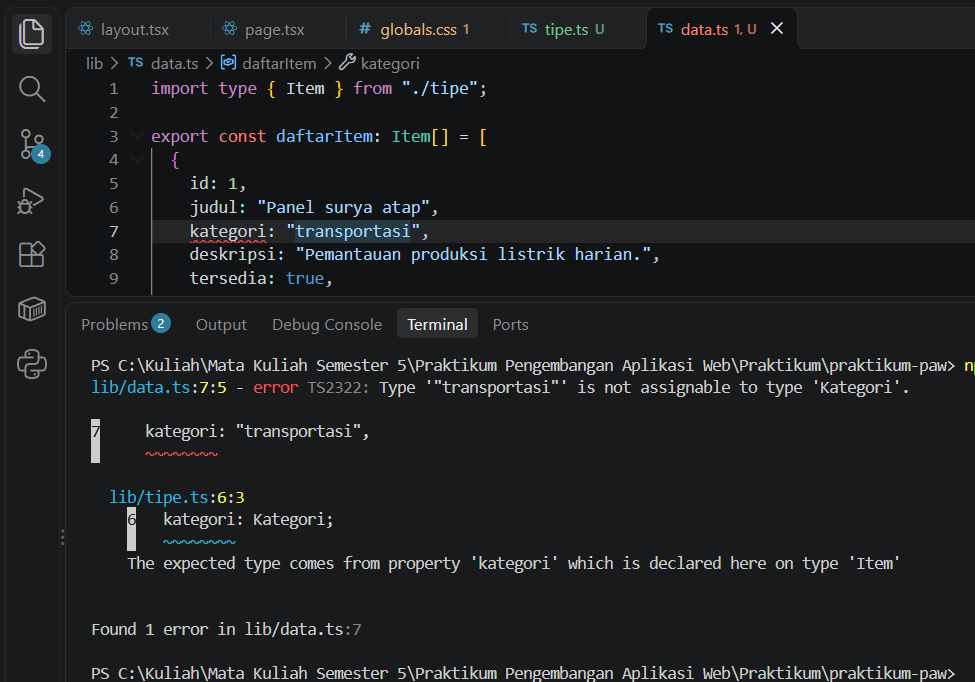
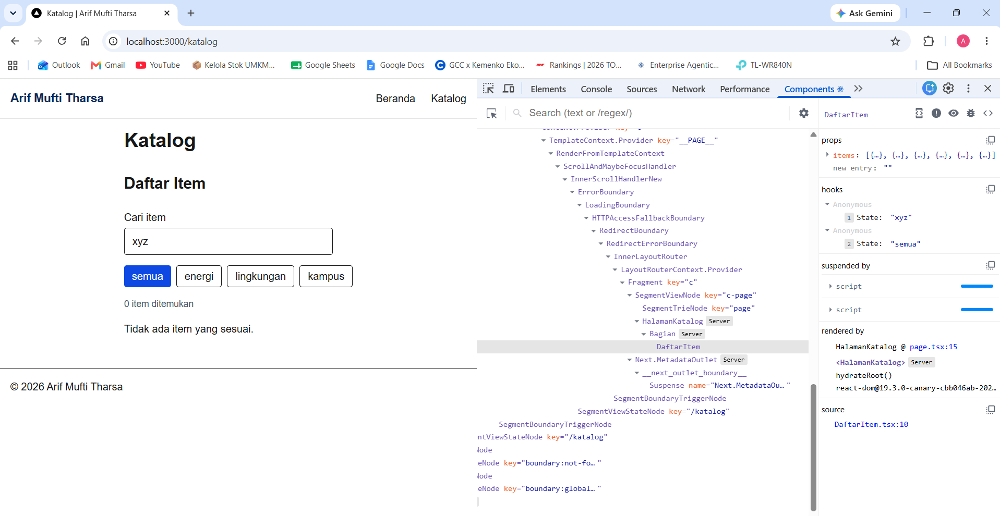
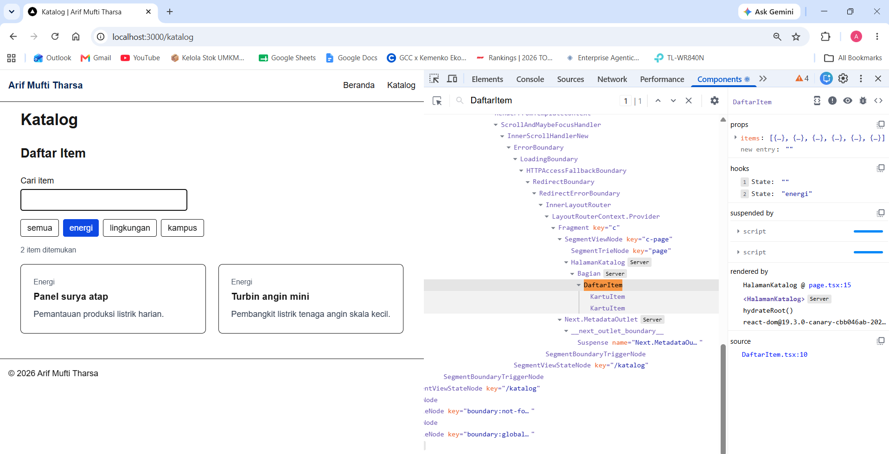
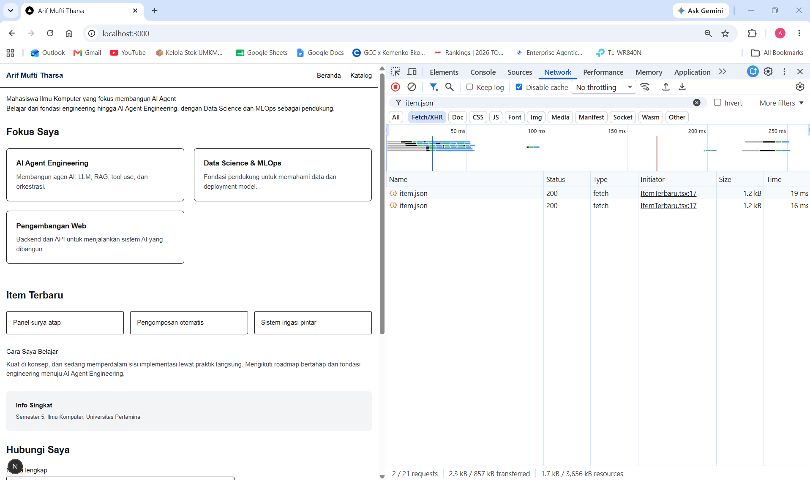
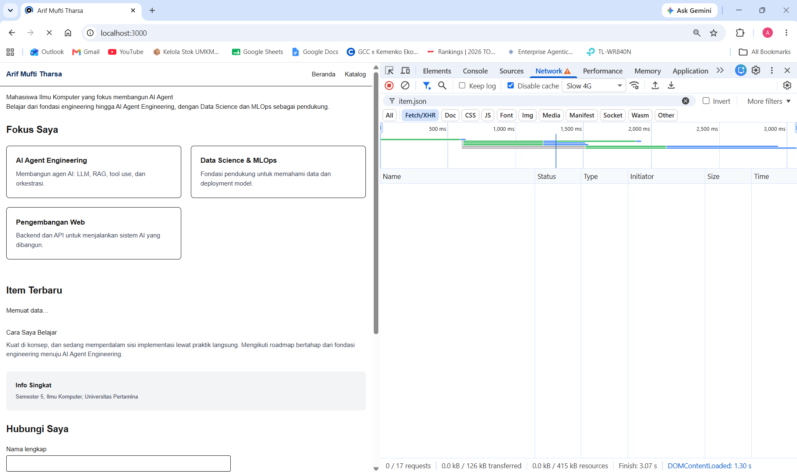
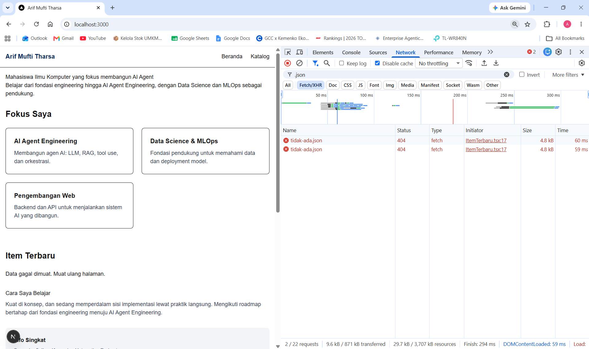

# Dokumen Teknis Modul 3 — TypeScript dan Komponen React

Nama/NIM : Arif Mufti Tharsa / 105224041
Repositori : https://github.com/arifmuftitharsa/praktikum-paw

## 1. Tipe Data Produk

Isi `lib/tipe.ts`:

```ts
export type Kategori = "energi" | "lingkungan" | "kampus";

export interface Item {
  id: number;
  judul: string;
  kategori: Kategori;
  deskripsi: string;
  tersedia: boolean;
  gambar?: string;
}
```

Entitas yang dipakai adalah `Item` dari contoh modul. Data tiruan di `lib/data.ts` berjumlah enam item dari asisten praktikum: dua item energi, dua lingkungan, dan dua kampus.

| Properti | Tipe | Alasan |
|---|---|---|
| `id` | `number` | Pengenal unik tiap item, dipakai sebagai `key` saat daftar ditampilkan |
| `judul` | `string` | Nama item, dipakai juga sebagai bahan pencarian |
| `kategori` | `Kategori` (union) | Nilainya dibatasi pada tiga pilihan yang sah |
| `deskripsi` | `string` | Penjelasan singkat item |
| `tersedia` | `boolean` | Menentukan apakah pesan "Sementara tidak tersedia" tampil |
| `gambar?` | `string` (opsional) | Boleh tidak ada |

**Alasan memakai union type.** Jika `kategori` bertipe `string`, salah ketik seperti `"transportasi"` tidak terdeteksi sampai halaman tampil salah. Dengan union dari literal type, TypeScript menolak nilai di luar tiga pilihan sebelum aplikasi dijalankan. Untuk membuktikannya, kategori item pertama saya ubah sementara menjadi `"transportasi"`, lalu `npx tsc --noEmit` dijalankan:

```
lib/data.ts:7:5 - error TS2322: Type '"transportasi"' is not assignable to type 'Kategori'.

7     kategori: "transportasi",
      ~~~~~~~~

  lib/tipe.ts:6:3
    6   kategori: Kategori;
        ~~~~~~~~
    The expected type comes from property 'kategori' which is declared here on type 'Item'

Found 1 error in lib/data.ts:7
```



Galat menunjuk ke `lib/data.ts` baris 7 (lokasi nilai yang salah) dan ke `lib/tipe.ts` baris 6 (tempat tipe yang diharapkan dideklarasikan). Nilai tersebut kemudian dikembalikan menjadi `"energi"` dan `tsc` kembali tanpa galat.

**Alasan memakai properti opsional.** `gambar?: string` diberi tanda tanya karena keenam data tiruan tidak memiliki gambar. Jika `gambar` wajib, `tsc` akan menolak semua item karena properti itu tidak ada.

**Pembagian interface dan type alias.** Mengikuti modul, `interface` dipakai untuk entitas data (`Item`) dan props komponen, sedangkan `type` dipakai untuk union (`Kategori`) dan bentuk sederhana (`Tautan` pada `SiteHeader`). Pada `KartuItem`, tipe `Record<Kategori, string>` memastikan setiap kategori memiliki label: bila kategori baru ditambahkan di `lib/tipe.ts` tanpa label, pemeriksa tipe akan melaporkannya.

## 2. Struktur Komponen

Diagram pohon komponen akhir:

```
RootLayout (app/layout.tsx)                          Server
├── SiteHeader                                       Server
├── {children}
│   ├── Beranda (app/page.tsx)                       Server
│   │   ├── Bagian "Fokus Saya"                      Server
│   │   ├── Bagian "Item Terbaru"                    Server
│   │   │   └── ItemTerbaru                          Client
│   │   └── Bagian "Hubungi Saya"                    Server
│   └── HalamanKatalog (app/katalog/page.tsx)        Server
│       └── Bagian "Daftar Item"                     Server
│           └── DaftarItem                           Client
│               └── KartuItem (diimpor Client)       ikut Client
└── SiteFooter                                       Server
```

Tabel komponen:

| Komponen | Props dan tipenya | Tempat digunakan | Jenis |
|---|---|---|---|
| `SiteHeader` | `namaProduk: string`, `tautan: Tautan[]` | `app/layout.tsx` | Server |
| `SiteFooter` | `namaProduk: string` | `app/layout.tsx` | Server |
| `Bagian` | `id: string`, `judul: string`, `children: React.ReactNode` | `app/page.tsx` (3 kali), `app/katalog/page.tsx` (1 kali) | Server |
| `KartuItem` | `item: Item` | `DaftarItem` | ikut Client |
| `DaftarItem` | `items: Item[]` | `app/katalog/page.tsx` | Client |
| `ItemTerbaru` | tanpa props | `app/page.tsx` | Client |

**Alasan pemecahan komponen:**

| Keputusan | Alasan |
|---|---|
| Header dan footer dipindah ke `app/layout.tsx` | Tampil di semua halaman, termasuk `/katalog`, tanpa ditulis ulang di tiap halaman |
| `Bagian` dibuat sebagai pembungkus dengan `children` | Pola `<section>` + `<h2>` + `aria-labelledby` yang di Modul 2 ditulis berulang kini cukup diisi `id` dan `judul`. Id judul dibentuk dari `id` (`judul-${id}`), sehingga hubungan `aria-labelledby` tetap terjaga |
| `KartuItem` dipisah dari `DaftarItem` | Satu cetakan kartu dipakai untuk setiap item, sehingga `DaftarItem` hanya mengurus pencarian, filter, dan daftar |
| `SiteFooter` dibuat mengikuti pola `SiteHeader` | Modul hanya menyebut "dengan cara yang sama" tanpa kode, sehingga isinya saya susun dari footer Modul 2 |

**Alasan penempatan `"use client"`.** Hanya dua berkas yang diberi direktif ini: `DaftarItem` (memakai `useState` serta event `onChange` dan `onClick`) dan `ItemTerbaru` (memakai `useState` dan `useEffect`). Hook dan event handler hanya dapat berjalan di Client Component. Komponen lain tidak memiliki state maupun event, sehingga tetap Server Component dan kodenya tidak dikirim ke peramban. Halaman `/katalog` sengaja tetap Server Component karena hanya mengambil data dari `lib/data.ts` dan meneruskannya lewat props ke `DaftarItem`; interaksinya ditangani komponen di bawahnya. Dengan begitu direktif diletakkan sedalam mungkin pada pohon komponen, hanya pada bagian yang memerlukan interaksi. `KartuItem` tidak diberi direktif sendiri, tetapi karena diimpor oleh Client Component ia ikut berjalan di peramban. `Bagian` (Server) dapat membungkus `DaftarItem` (Client) melalui `children` tanpa masalah.

## 3. State dan Interaksi

Tangkapan layar tab Components dengan `DaftarItem` dipilih. Props `items` berisi enam objek, dan panel hooks menampilkan dua state: state 1 bernilai `"xyz"` (`kataKunci`) dan state 2 bernilai `"semua"` (`filter`). Pada pohon komponen, `HalamanKatalog` dan `Bagian` berlabel Server, sedangkan `DaftarItem` tidak berlabel, sesuai dengan penempatan `"use client"`.



Pengujian kedua: nilai state `filter` diubah langsung dari panel Components menjadi `"energi"`. Halaman ikut berubah tanpa ada yang saya klik di halaman: tombol `energi` aktif, tampil "2 item ditemukan", dan hanya dua kartu energi yang muncul.



| State | Tipe | Nilai awal | Diubah oleh |
|---|---|---|---|
| `kataKunci` | `string` | `""` | `onChange` pada kolom cari |
| `filter` | `Filter` (`Kategori` atau `"semua"`) | `"semua"` | `onClick` pada tombol filter |

**Alur dari event hingga render ulang:**

1. Pengguna mengetik di kolom cari sehingga event `onChange` dijalankan.
2. Handler memanggil `setKataKunci(e.target.value)`.
3. React menjadwalkan render ulang `DaftarItem` dengan nilai `kataKunci` yang baru.
4. Pada render itu, `hasil` dihitung ulang dari `items`, `kataKunci`, dan `filter` melalui `items.filter(...)`.
5. Daftar kartu dan teks "N item ditemukan" mengikuti `hasil` yang baru.

`hasil` sengaja tidak dijadikan state karena nilainya selalu dapat diturunkan dari props dan dua state lain; menyimpannya sebagai state ketiga berisiko tidak sinkron. Kolom cari berupa *controlled input* (`value={kataKunci}` dan `onChange`), sehingga isinya selalu berasal dari state. Setiap elemen daftar memakai `key={item.id}` karena `id` unik dan stabil, berbeda dari indeks larik yang bergeser ketika hasil disaring.

Hasil uji di halaman `/katalog`:

| Masukan | Hasil yang tampil |
|---|---|
| Kata kunci `Sensor` | 1 item (Sensor kualitas udara) |
| Filter `energi` | 2 item (Panel surya atap, Turbin angin mini) |
| Filter `energi` dan kata kunci `turbin` | 1 item (Turbin angin mini) |
| Kata kunci `xyz` | 0 item dan pesan "Tidak ada item yang sesuai." |

## 4. Pengambilan Data

Data tiruan disalin ke `public/data/item.json` (enam objek) dan dimuat oleh `ItemTerbaru` melalui `fetch("/data/item.json")` di dalam `useEffect`. Hasilnya, tiga item pertama tampil pada bagian "Item Terbaru" di halaman utama. Berkas JSON dapat diakses langsung di `http://localhost:3000/data/item.json`.

| Kondisi | Cara memicu | Hasil | Bukti |
|---|---|---|---|
| Berhasil | Muat halaman utama dengan "Disable cache" aktif | `item.json` berstatus 200, tipe `fetch`, initiator `ItemTerbaru.tsx:17`, tiga item tampil | Gambar di bawah |
| Memuat | Throttling "Slow 4G", lalu muat ulang | Teks "Memuat data…" tampil selama permintaan belum selesai | Gambar di bawah |
| Gagal | Alamat diubah sementara menjadi `/data/tidak-ada.json` | Status 404 dan pesan "Data gagal dimuat. Muat ulang halaman." | Gambar di bawah |







Setelah pengujian gagal, alamat dikembalikan ke `/data/item.json` dan dipastikan dengan `findstr "tidak-ada" components\ItemTerbaru.tsx` yang tidak menghasilkan keluaran.

**Alasan memeriksa `res.ok`.** `fetch()` hanya menolak (reject) saat jaringan gagal. Respons 404 atau 500 tetap diterima sebagai respons biasa, sehingga tanpa `if (!res.ok) throw new Error(...)` kondisi 404 tidak akan masuk ke status `gagal`.

**Alasan variabel `dibatalkan` dan fungsi pembersih.** Jika komponen sudah tidak tampil sebelum data tiba, state tidak boleh diperbarui lagi. Fungsi pembersih mengubah `dibatalkan` menjadi `true`, dan pembaruan state hanya dijalankan bila nilainya masih `false`. Larik dependensi kosong `[]` membuat efek hanya berjalan setelah komponen pertama kali tampil.

**Dua hal yang terlihat pada panel Network:**

- Permintaan `item.json` muncul dua kali. Pada mode pengembangan, React Strict Mode menjalankan efek dua kali untuk membantu menemukan bug, dan hal ini tidak terjadi pada versi produksi.
- Sebelum "Disable cache" dicentang, statusnya 304 (Not Modified): peramban sudah memiliki salinan berkas dan server hanya mengonfirmasi isinya tidak berubah. Dengan cache dimatikan, statusnya 200 dengan ukuran 1,2 kB.

**Batasan pola ini.** Pengambilan data lewat `useEffect` di Client Component dipilih agar lalu lintas permintaan dapat diamati di panel Network. Dokumentasi React menganjurkan agar penggunaannya dibatasi, dan pengambilan data di server dibahas mulai Modul 4. Tipe `Item[]` pada `res.json()` hanya berupa pernyataan tipe (*type assertion*): isi data tidak divalidasi saat aplikasi berjalan. Validasi data dengan Zod dibahas pada Modul 5.

## 5. Verifikasi

```
PS> npx tsc --noEmit
(tidak ada keluaran)

PS> npm run lint

> praktikum-paw@0.1.0 lint
> eslint
(tidak ada galat maupun peringatan)
```

Pekerjaan dilakukan pada branch `praktikum/modul-03` dan digabungkan melalui Pull Request #5: https://github.com/arifmuftitharsa/praktikum-paw/pull/5 (Merged, commit `ba352b0`).

Daftar commit pada branch tersebut:

```
163368a feat: tambahkan tipe data dan data tiruan produk
4db4408 feat: pecah header dan footer menjadi komponen
61e967f feat: tambahkan Bagian dan KartuItem, pakai Bagian di halaman utama
9ed636b feat: tambahkan halaman katalog dengan pencarian dan filter
30f2dda feat: muat data tiruan dengan Fetch API
bb87fc5 docs: tambahkan bukti perubahan state lewat React DevTools
ba352b0 Merge pull request #5 from arifmuftitharsa/praktikum/modul-03
```

## 6. Kendala dan Penyelesaian

Saat memulai persiapan, `git status` menjawab "not a git repository" karena terminal masih berada di `C:\Users\Arif`, bukan di folder proyek. Folder `C:\Users\Arif\Projects\praktikum-paw` ternyata repo git kosong ("No commits yet"), sehingga bukan repo yang dipakai di Modul 1 dan 2. Repo yang benar berada di `C:\Kuliah\Mata Kuliah Semester 5\Praktikum Pengembangan Aplikasi Web\Praktikum\praktikum-paw`. Saya pindah ke folder tersebut, memastikan `git status` menampilkan branch `main` yang bersih, lalu membuat branch `praktikum/modul-03`.

Saat memeriksa `git status` sebelum commit pertama, `package.json` dan `package-lock.json` tercatat berubah (`"typescript": "^5"` menjadi `"^5.9.3"`), padahal tidak ada paket yang saya pasang pada modul ini. Penyebab pastinya belum saya ketahui. Karena tidak berkaitan dengan Modul 3, perubahan itu dibuang dengan `git restore package.json package-lock.json`, dan `git add` selalu dilakukan per berkas agar keduanya tidak ikut ter-commit. Hasilnya, PR #5 hanya memuat berkas Modul 3.

Tangkapan layar pertama untuk galat tipe tersimpan dengan nama `modul-03-tsc-galat.png.png`, karena Windows menyembunyikan ekstensi berkas dan dialog simpan menambahkan `.png` sekali lagi. Hal ini terdeteksi dari daftar `Untracked files` pada `git status` dan diperbaiki dengan `Rename-Item` sebelum commit.

Saat mencari permintaan yang gagal di panel Network, daftar tampil kosong. Penyebabnya, kotak filter berisi `404` yang mencocokkan nama berkas, bukan kode status, sementara tombol tipe Fetch/XHR juga aktif. Untuk pengujian berikutnya saya memfilter berdasarkan nama berkas (`item.json`, lalu `.json`) dengan tipe Fetch/XHR, karena permintaan data memang berasal dari `fetch`.

Tangkapan layar tab Components yang pertama belum memuat nilai state, karena dua entri "Anonymous" pada panel hooks masih tertutup. Entri itu saya buka sehingga nilai `"xyz"` dan `"semua"` terlihat, lalu tangkapan layar diambil ulang sebelum disimpan. Hook tidak memiliki nama di DevTools karena `useState` tidak menyimpan nama variabelnya, sehingga urutan hook mengikuti urutan pemanggilan `useState` pada kode.

## 7. Catatan Pemanfaatan AI

Alat yang dipakai: Claude di claude.ai.

| No | Untuk apa | Prompt/perintah utama | Bagian yang saya pakai | Cara saya verifikasi |
|---|---|---|---|---|
| 1 | Bimbingan mengerjakan Modul 3 | Tanya jawab langkah demi langkah untuk Bagian 1 sampai 5, termasuk membaca hasil terminal dan panel DevTools | Penjelasan konsep tipe, props, state, dan Fetch API dipakai untuk menyusun bagian penjelasan pada dokumen ini | Saya bandingkan dengan isi Modul 3 dan periksa langsung di terminal, tab Components, dan panel Network milik saya sendiri |
| 2 | Kode komponen dan data | Meminta kode `lib/tipe.ts`, `lib/data.ts`, `SiteHeader`, `Bagian`, `KartuItem`, `DaftarItem`, halaman `/katalog`, dan `ItemTerbaru` mengikuti modul | Kode berkas-berkas tersebut | `npx tsc --noEmit` setelah setiap berkas, `npm run lint`, uji pencarian, filter, dan hasil kosong di `/katalog`, serta pengujian tiga kondisi pengambilan data |
| 3 | `SiteFooter` serta penulisan ulang `layout.tsx` dan `page.tsx` | Meminta kode `SiteFooter` karena modul tidak memberikannya, dan penulisan ulang penuh `app/layout.tsx` dan `app/page.tsx` agar isi Modul 2 tidak rusak | Kode `SiteFooter` dan kedua berkas hasil penulisan ulang | Saya cocokkan dengan isi berkas Modul 2 yang saya kirim, jalankan `tsc`, dan cek di peramban bahwa seluruh bagian halaman utama tetap tampil |
| 4 | Menelusuri kendala Git dan DevTools | Menempelkan keluaran terminal dan tangkapan layar yang bermasalah (folder salah, `package.json` berubah, nama berkas ganda, panel Network kosong) | Arah penyelesaian untuk tiap kendala | Saya jalankan ulang `git status` dan `git log` untuk memastikan hasilnya, dan mengulang pengambilan tangkapan layar |
| 5 | Menyusun Dokumen Teknis | Meminta kerangka dan draf teks mengikuti Bagian H modul dan format dokumen Modul 1 dan 2 | Susunan dokumen dan draf kalimat penjelasan | Seluruh isi saya cocokkan dengan hasil kerja saya sendiri: kode di repositori, keluaran terminal, dan tangkapan layar |
